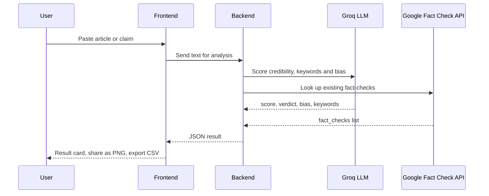

<div align="center">

# 🛡️ FakeShield

### AI misinformation detector — it scores credibility *and* exposes editorial bias


[🚀 **Live Demo**](https://fakeshield-nine.vercel.app) · [✨ Features](#-features) · [🔄 How it works](#-how-it-works) · [⚙️ Run locally](#️-run-locally)

</div>

<!-- TODO: add a screenshot or GIF of a result card
<p align="center"></p>
-->

---

## 💡 The idea

A news article can be **factually real but still heavily biased**. Most fact-checkers only answer "true or false". FakeShield gives a **credibility score** and also tells you *which way the article leans*, so readers can judge the framing, not just the facts.

## ✨ Features

| Feature | Details |
|---|---|
| 🧠 **Credibility score** | AI-generated score with a verdict and written analysis |
| ⚖️ **Bias detection** | Labels the slant of the text (see table below) |
| 🚩 **Suspicious keywords** | Highlights manipulative or sensational phrases |
| 🔎 **Fact-check lookup** | Shows existing results from the Google Fact Check API |
| 📸 **Share as image** | Export a result card as PNG |
| ⬇️ **History export** | Download past analyses as CSV |

<details>
<summary><b>⚖️ Bias labels</b> (click to expand)</summary>

<br/>

| Label | Meaning |
|---|---|
| Neutral | Balanced reporting |
| Left-Leaning | Leans towards left-wing framing |
| Right-Leaning | Leans towards right-wing framing |
| Sensationalist | Emotional or clickbait-style language |
| Pro-Government | Favourable framing of the government |
| Anti-Government | Critical framing of the government |

</details>

## 🔄 How it works



> The final score is **fully AI-based**. Fact-check results are shown next to it for reference and are not mixed into the score, so one unrelated fact-check can never drag a correct score down.

## 🧰 Tech Stack

| Layer | Technology |
|---|---|
| Frontend | Vite (JavaScript), deployed on Vercel |
| Backend | Python |
| AI | Groq LLM |
| Data | Google Fact Check API |

<!-- VERIFY: add the exact frontend library (React?) and backend framework (Flask?) if you want them listed here -->

## ⚙️ Run locally

**1. Clone**
```bash
git clone https://github.com/mishrapranshu9161/fakeshield.git
cd fakeshield
```

**2. Backend**
```bash
cd backend
pip install -r requirements.txt
```
Create a `.env` file:
```env
GROQ_API_KEY=your_groq_key
GOOGLE_FACT_CHECK_API_KEY=your_google_key
```
```bash
python app.py
```

**3. Frontend**
```bash
cd frontend
npm install
npm run dev
```
Open **http://localhost:5173**.

<!-- VERIFY: folder names (backend/frontend) and .env variable names must match your repo -->

## ⚠️ Limitations

- Scores come from an LLM, so treat them as a **decision aid, not ground truth**.
- Bias labels depend on the text provided; very short inputs give weaker results.
- Fact-check coverage depends on what the Google Fact Check API has indexed.

## 📝 Changelog

<details>
<summary>Recent updates</summary>

<br/>

- Added **bias detection** (6 labels)
- Score is now **100% AI-based**; fact-check results are displayed separately
- Added **share as PNG** and **CSV history export**

</details>

## 👨‍💻 Author

**Pranshu Mishra** · B.Tech CSE, SRMU Lucknow

[](https://www.linkedin.com/in/pranshu-mishra-386873322)
[](https://github.com/mishrapranshu9161)

⭐ If you found this useful, consider giving it a star.
